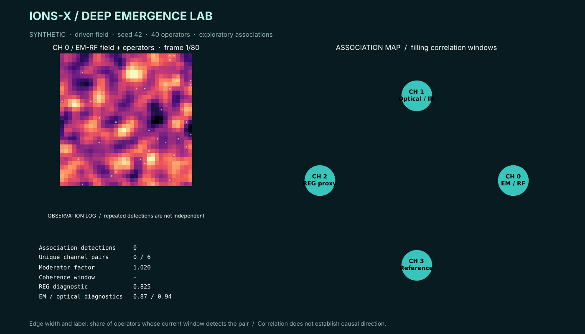
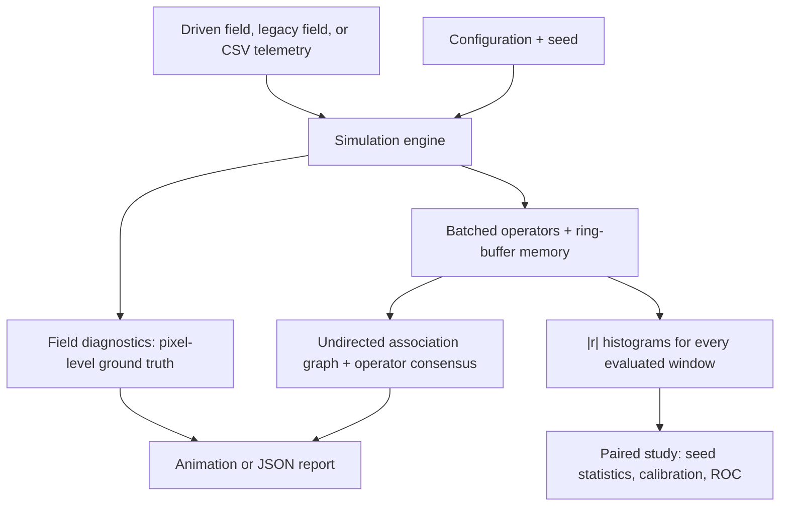

# IONS-X Deep Emergence Lab

> A reproducible sandbox for asking whether collective sensing can recover structure in a changing field—and what remains when that structure is removed.

[](https://github.com/topherchris420/ions-x-deep-emergence-lab/actions/workflows/ci.yml)




*Actual 80-frame run: 40 operators (dots) on a 32×32 driven field, seed 42. Each edge's width and label show the share of operators whose current window detects that pair.*

IONS-X places moving sensing agents inside a four-channel field. Agents retain observations, measure rolling correlations, and contribute to a shared, decaying association graph. You can watch a run, analyze sensor CSVs, or run paired synthetic experiments without rendering a single frame.

**The useful question is not simply “did a pattern appear?” It is “does the detector respond differently when the injected coupling is absent, and how often does it fire when nothing was injected at all?”** The paired control study makes both questions executable, and answers them with seeds as the only independent units.

This is exploratory simulation software from Vers3Dynamics. Its outputs are associations, not demonstrations of causality, consciousness, or nonlocal effects. “Confidence” in legacy exports means absolute Pearson correlation, not statistical confidence. See [experiment design and limitations](docs/experiment-design.md).

## What version 0.5 found in its own generator

A benchmark is only as honest as the thing it measures. Version 0.5 added instruments that look at the synthetic field directly, pixel by pixel, instead of through the agents. Pointed at the generator every earlier result came from, they found three defects:

1. **The field froze.** The legacy update `0.92·F + 0.08·tanh(4F)` has gain 1.24 near zero, so every pixel grows until it saturates near ±1. Within about 60–100 frames the “changing field” is a fixed pattern.
2. **It had no spatial structure.** The diffusion kernel omitted the (2π)² of the Laplacian, so it removed at most 0.07% of the finest detail per frame. Neighbouring pixels were unrelated, as in white noise.
3. **The “coherence-window” coupling was permanent.** One window copied channel 2 into channel 3, and the frozen dynamics kept the copy for the rest of the run. The bimodal 0%/96% ch2–ch3 seeds in the 0.4 benchmark came from this.

The new default is a **driven-dissipative field**. Each frame, every channel relaxes with persistence `FIELD_MEMORY`, diffuses through a true Laplacian, and is renewed by spatially correlated forcing noise. The two paired arms receive identical noise, so the injected couplings remain the only difference between them.

| Field property, measured over every pixel | Legacy (≤ 0.4) | Driven (0.5 default) |
| --- | ---: | ---: |
| Correlation with itself one 50-frame window later | → 1.00 (frozen) | 0.00 |
| Correlation between neighbouring pixels | 0.00 | 0.82 |
| ch2–ch3 correlation 75 frames after a coherence window | 1.00 (permanent copy) | ≈ 0 (fades) |
| Uncoupled-arm false alarms at \|r\| > 0.32 (nominal 2.35%) | 6.0% | 8.8% |

Nothing was deleted. `--dynamics legacy` reproduces 0.4 bit for bit. A test regenerates the [committed 0.4 benchmark](docs/benchmarks/legacy-0.4/control-study.json) from scratch and requires every count to match.

## Start with one experiment

```bash
git clone https://github.com/topherchris420/ions-x-deep-emergence-lab.git
cd ions-x-deep-emergence-lab
python -m venv .venv
source .venv/bin/activate     # Windows PowerShell: .\.venv\Scripts\Activate.ps1
python -m pip install -e .

ions-x --quick --seed 42 --live
```

Open `outputs/latest.html`. The adjacent `outputs/latest.metrics.json` records detections, unique channel pairs, field diagnostics, the effective configuration, code identity, dependency versions, and seed.

The animation shows the channel-0 field with every operator's position, the association map, and the observation log. The map draws **operator consensus**: the share of operators whose current window detects each pair. The shared graph keeps each pair's strongest recent |r| from any operator. With dozens of operators testing six pairs, chance detections alone keep every edge of that graph alive, so the strongest |r| cannot tell real coupling from noise; consensus can. The renderer and headless mode use the same engine, and rendering adds no observations.

## Ask what survives the control

```bash
ions-x --quick --control-study 8 --frames 100 --agents 40 --field-res 32 \
  --seed 42 --output outputs/control-study.json
```

For each seed, the engine runs two arms:

| Coupled field | Uncoupled field |
| --- | --- |
| Channel 1 feeds channel 0 every frame. | This contribution is disabled. |
| Channel 2 mixes into channel 3 during coherence windows only. | This contribution is disabled. |
| Seeded initial field, forcing noise, diffusion, saturation, moderator events, and agent paths. | Identical. |

Open `outputs/control-study.html` for the portable report. It works offline, needs no server, and contains no scripts. The adjacent JSON is the machine-readable evidence record. The [committed eight-seed benchmark](docs/benchmarks/control-study.html) shows:

| Pair | Injected | Coupled | Uncoupled | Difference | Seeds + / = / − | Holm p | AUC |
| --- | --- | ---: | ---: | ---: | :---: | ---: | ---: |
| ch0–ch1 | continuous | 56.99% | 9.07% | +47.92 pp | 8 / 0 / 0 | 0.047 | 0.83 |
| ch2–ch3 | coherence windows | 26.86% | 8.99% | +17.87 pp | 7 / 1 / 0 | 0.078 | 0.64 |
| ch0–ch2 | — | 11.00% | 8.30% | +2.70 pp | 7 / 0 / 1 | 0.094 | 0.52 |
| ch0–ch3 | — | 7.56% | 6.83% | +0.72 pp | 4 / 0 / 4 | 1.000 | 0.52 |
| ch1–ch2 | — | 11.19% | 11.19% | 0.00 pp | 0 / 8 / 0 | 1.000 | 0.50 |
| ch1–ch3 | — | 7.75% | 8.17% | −0.42 pp | 2 / 1 / 5 | 1.000 | 0.50 |

How to read it:

- **Seeds are the units.** Each seed gives one paired difference per pair. The sign-flip test enumerates all 2⁸ sign assignments exactly, and Holm's method controls the family-wise error across all six pairs. Agents and overlapping windows are dependent, so their counts are never treated as a sample size. With 8 seeds, 0.047 is the smallest Holm-adjusted p-value any pair can reach.
- **The continuous coupling is detected in every seed.** The transient one is detected whenever a coherence window occurred. Seed 44 had none and shows exactly zero difference. With 8 seeds, the transient coupling does not clear the family-wise bar.
- **ch0–ch2 moves without any direct coupling.** Feeding channel 1 into channel 0 changes channel 0's texture, and with it its chance agreement with channel 2 (raw p = 0.023, Holm p = 0.094). This is why every pair is reported and corrected, not only the injected ones.
- **ch1–ch2 is identical in every seed.** Neither ablated term touches those channels, and the arms share every random draw. This is a built-in check that the pairing works.
- **AUC is threshold-free:** the chance that a coupled window shows a stronger |r| than an uncoupled one. 0.5 means no separation.

A detection rate is detections divided by eligible agent-windows. It is not the probability of a true relationship. This is a coupling ablation benchmark for the synthetic generator, distinct from `--preset baseline`, and neither is a validated null model for arbitrary empirical data.

## Ask whether the detector is honest

Two unrelated channels sampled 50 independent times exceed |r| > 0.32 in **2.35%** of windows. That is the textbook false-alarm rate the threshold implies. Every pair in the uncoupled arm is unrelated by construction, and there the detector fires in **8.8%** of windows, 3.7 times as often. An operator drifting through a smooth, slowly changing field takes samples that partly repeat one another. The report inverts the textbook formula: each 50-sample window behaves like about **30 independent samples**.

The report then recalibrates on held-out seeds. The uncoupled arms of seeds 42, 44, 46 and 48 choose the threshold that restores the nominal rate: |r| ≥ 0.42. Seeds 43, 45, 47 and 49 never influenced that choice. On them, it gives **2.1%** false alarms, close to the 2.35% target. Sensitivity falls from 55% to 32% for ch0–ch1 and from 24% to 13% for ch2–ch3. That trade-off is the honest price of a calibrated detector, and it is now visible rather than hidden in an optimistic threshold.

## Run without rendering

```bash
ions-x --quick --headless --frames 200 --seed 42 --output outputs/run.json
```

Headless mode writes one JSON report and skips Matplotlib rendering, which suits batch work and reproducibility checks. The report records the actual number of processed frames and separates repeated detections from unique associations. Its `evaluation` section records eligible agent-windows and all six detection rates. Its `field_diagnostics` section records the field's pixel-level pair correlations, its memory across one window, and its neighbour correlation. Runs shorter than the correlation window are labeled `insufficient_observations`, with null rates; zero detections after evaluation remain numeric zero.

```python
import ions_x_deep_emergence as lab

result = lab.main([
    "--quick", "--headless", "--frames", "100",
    "--seed", "42", "--output", "outputs/experiment.json",
])
print(result.summary_path)
```

CLI and `main()` calls reset configuration before applying options, so a previous experiment cannot silently change the next one. The lower-level `SimulationEngine` API uses the module configuration and RNG: configure once, then run sequentially. Concurrent engines are not supported. The engine moves, samples and correlates all agents as one batch per frame, drawing random numbers in the original per-agent order. It is about eight times faster than 0.4 with identical results. `engine.agents` keep their `pos`, `memory`, `observe` and `discover` interface.

## Analyze sensor telemetry

```bash
ions-x --preset empirical --input-data telemetry.csv --headless \
  --output outputs/telemetry.json
```

| Channel | Canonical input | Selected aliases |
| --- | --- | --- |
| 0: EM / RF | `em_rf` | `magnetometer`, `rf_noise`, `rf_spectrum_noise`, `channel_0` |
| 1: Optical / IR | `optical_ir` | `pixel_variance`, `sky_pixel_variance`, `ir_anomaly`, `channel_1` |
| 2: REG proxy | `consciousness_proxy` | `reg_variance`, `reg_entropy`, `egg_variance`, `channel_2` |
| 3: Reference | Generated locally | Independent Gaussian series in empirical mode |

All three measured channels must contain numeric data. Missing or wholly unusable channels and infinite sensor/covariate values are rejected. Partial gaps retain the legacy offline forward-fill/backward-fill behavior, with imputed sensor-cell counts in the report. Optional covariates are `kp_index`, `lunar_phase`, `sidereal_time`, and `xray_flux`; absent covariates default to zero and are listed in the report.

An optional timestamp column accepts `timestamp`, `time`, `datetime`, `date_time`, or `utc_timestamp`. Missing/invalid timestamps are filled, or replaced with a synthetic minute index when none are valid. Input ordering is preserved. Rows are steps; elapsed timestamp gaps do not change the dynamics.

Empirical processing projects standardized series onto synthetic spatial bases. Frames are projected on demand, so memory grows with the number of rows plus one grid. Earlier versions grew with rows times grid, about 5 GB for 20,000 rows at the default resolution. This is an **offline exploration**, with full-series normalization and backward filling that can use future rows. It is not a causal online estimator. The environmental moderator equations are modeling assumptions, not validated physical relationships.

Runs also export `longitudinal_run_<unique-id>.csv.gz` and `metadata_<unique-id>.json` beside the requested output. Requests longer than the input are clamped to available rows and report the actual frame count. The passport includes the input file's SHA-256 and preprocessing information.

## Choose a configuration

```bash
ions-x --experiment coherence --seed 123 --output outputs/coherence.html
ions-x --quick --output outputs/demo.gif
ions-x --preset baseline --headless --frames 100 --output outputs/baseline.json
ions-x --quick --control-study 8 --dynamics legacy --output outputs/legacy.json
```

| Flag | Purpose |
| --- | --- |
| `--quick` | 50 agents, 64×64 field, 60 frames; explicit numeric flags override these values. |
| `--experiment NAME` | `balanced`, `quick`, `arv`, `coherence`, or `dense-agents`. |
| `--frames N`, `--agents N`, `--field-res N` | Positive integer runtime settings. |
| `--seed N` | NumPy RandomState seed, 0 through 4294967295. |
| `--dynamics MODE` | `driven` (default) or `legacy` to reproduce ≤ 0.4 results. Synthetic fields only. |
| `--headless` | JSON report without animation. |
| `--control-study N` | N paired seeds beginning at `--seed`; synthetic only, JSON plus an offline HTML report. |
| `--preset MODE` | `synthetic`, `empirical`, or `baseline`. |
| `--input-data PATH` | CSV telemetry; supplying a CSV without a preset is labeled empirical. |
| `--output PATH` | `.html` / `.gif` for animation, `.json` for headless or paired study. |
| `--fps N` | GIF playback frame rate; default 20. |
| `--live` | Stream progress for individual runs. |
| `--show` | Display the saved animation in an IPython notebook. |
| `--no-metrics-sidecar` | Omit the extra animation summary; headless/study JSON remains the primary output. |

| Experiment | Active differences from balanced |
| --- | --- |
| `balanced` | 300 agents, 128×128 field, 500 frames; 50-observation correlation window, threshold 0.32. |
| `quick` | 50 agents, 64×64 field, 60 frames. |
| `arv` | Memory 500, window 80, threshold 0.28, 400 frames. Historical preset name; no remote-viewing validation. |
| `coherence` | 400 agents, threshold 0.26, decay 0.997, 300 frames. |
| `dense-agents` | 800 agents, 96×96 field, 200 frames. |

The driven generator is set by four recorded parameters. `FIELD_MEMORY` (0.95) gives a correlation time of 20 frames. `FIELD_CORRELATION_LENGTH` (1 pixel) sets the scale of the forcing noise. `COUPLING_STRENGTH` (0.08) and `COHERENCE_MIXING` (0.25) set the two injected terms. Raising the correlation length well above the step size of 3 pixels shows the detector's false-alarm rate climbing as samples become redundant.

`perceiver`, `forecaster`, and `integrator` currently label the **same rolling Pearson detector**. `LAG_FRAMES`, `SAMPLE_PER_FRAME`, and the three legacy moderator toggles do not alter the current engine; the passport lists these inactive settings, along with any generator settings the run did not use. No lagged forecasting or distinct operator algorithm is claimed.

## Architecture



The ATOM framing organizes **analyses, targets, operators, and moderators**. The engine owns sequential state advancement; an explicit animation initializer prevents extra frame-zero steps, and duplicate requests for the current frame return its existing snapshot. Metrics, CSV records, diagnostics and visualization therefore share one frame clock.

## Reproduce and contribute

```bash
python -m pip install -e '.[dev]'
python -m ruff check .
python -m pytest -q
python -m build
```

The tests compare real HTML and GIF execution against headless metrics, and check exact frame counts and paired random schedules. They cover configuration isolation, empirical input rejection, provenance, and graph decay. They also regenerate both committed benchmarks exactly. They show that the legacy field freezes and the driven field does not, and that coherence coupling fades only in the driven field. The textbook false-alarm rate is checked against the t distribution and against the detector's own code on 40,000 independent windows. CI runs Python 3.10–3.12, verifies the wheel build, and uploads rendered, headless, paired-study and legacy smoke artifacts.

Reproducibility means matching scientific metrics for the same code, input, effective configuration, backend, and dependency environment. Timestamps and output paths vary; CPU/GPU and dependency versions can introduce numerical differences. The passport records these distinctions rather than promising byte-identical output everywhere.

The [guided notebook](notebooks/quickstart.ipynb) introduces the existing API. See [CONTRIBUTING.md](CONTRIBUTING.md) and [experiment design](docs/experiment-design.md) before extending the detector.

MIT licensed. Built for open exploration.
